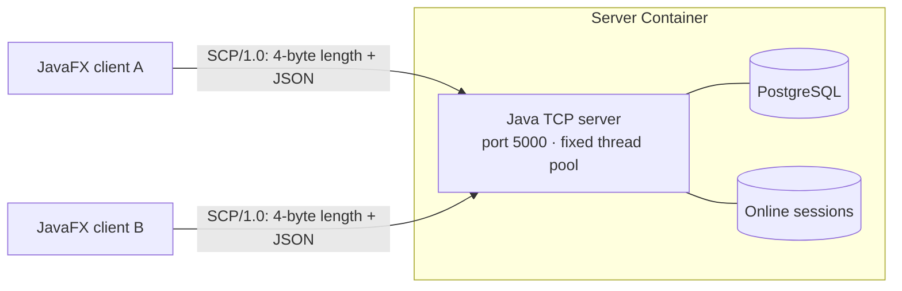

# Loop — JavaFX TCP Chat

> **Course:** Network Programming (INT1433) · PTIT · Instructor: Dr. Hung N. Dang
>
> Desktop chat JavaFX cho nhóm nhỏ, có đăng ký/đăng nhập và chat tổng thời gian thực qua giao thức TCP tự thiết kế.

👋 **New here? Read first:** [`docs/student-guide.md`](docs/student-guide.md) · 📜 Brief & grading: [`INSTRUCTION.md`](INSTRUCTION.md) · 🚀 Workflow: [`GETTING_STARTED.md`](GETTING_STARTED.md)

---

## 1. Thông tin nhóm (Team) — Bắt buộc

**Tên nhóm:** Nhóm 001

| **STT** | **Họ và tên** | **Mã sinh viên** | **Lớp** | **GitHub** | **Vai trò** |
|:-------:|---------------|------------------|---------|------------|-------------|
| 1 | Nguyễn Đức Hải | | Nhóm 05 | | Developer |
| 2 | Ngô Hoàng Minh | B23DCCN553 | Nhóm 05 | [@HuangMingo](https://github.com/HuangMingo) | Developer |
| 3 | Quách Thành Đạt | | Nhóm 05 | | Developer |

**Topic:** Desktop chat JavaFX có tài khoản và kênh chat tổng sử dụng Java TCP Socket

---

## 2. Problem & Idea (mandatory)

- **Problem:** Nhóm học tập/làm việc nhỏ cần một kênh chat tức thời có thể tự triển khai và không phụ thuộc dịch vụ bên thứ ba.
- **Our idea:** Người dùng đăng ký, đăng nhập trên giao diện JavaFX và trò chuyện trong một kênh chung; mỗi app mở một TCP socket trực tiếp tới server.
- **What makes it non-trivial:** Tự xử lý framing trên TCP, xác thực phiên, broadcast đồng thời và dọn trạng thái đúng khi kết nối bị ngắt.
- **Out of scope:** Nhiều phòng, nhắn riêng, file/thoại/video, OAuth, khôi phục mật khẩu qua email và hệ thống phân tán.

Full proposal: [`docs/proposal.md`](docs/proposal.md)

---

## 3. Features

- [x] **Account:** đăng ký/đăng nhập bằng email; `users(uid,email,password_hash)`, SHA-256 theo yêu cầu
- [x] **Connection & session:** handshake phiên bản, một tài khoản/một phiên online, logout/quit
- [x] **Custom protocol:** specified in [`docs/protocol-design.md`](docs/protocol-design.md)
- [x] **Concurrency:** fixed thread pool, concurrent session registry, per-socket send lock
- [x] **Robustness:** frame limit, malformed strikes, abrupt disconnect cleanup, idle timeout
- [x] **General chat:** lưu PostgreSQL và broadcast realtime
- [x] **Presence:** snapshot online và sự kiện join/leave

---

## 4. Architecture



| Aspect | Our choice | Why (one line) |
|--------|-----------|----------------|
| Language | Java 21 server + JavaFX client | Client mở TCP trực tiếp; một stack dễ giải thích |
| Transport | TCP | Tin cậy, đúng thứ tự và phù hợp chat văn bản |
| Framing | 4-byte big-endian length + UTF-8 JSON | Xử lý đúng TCP split/coalescing và giới hạn cấp phát |
| Concurrency model | Fixed thread pool | Giới hạn tài nguyên và dễ kiểm thử/giải thích |

Details: [`docs/architecture.md`](docs/architecture.md)

---

## 5. Quick Start

Start PostgreSQL and the Java TCP server:

```bash
cp .env.example .env          # or: make init
docker compose up --build -d  # build and start database + server
docker compose logs -f server database
docker compose down
```

Run one or more native JavaFX clients (new terminal per client):

```powershell
cd client
mvn javafx:run
```

The client defaults to `localhost:5000`; override `CLIENT_TARGET_HOST`/`CLIENT_TARGET_PORT` when needed. PostgreSQL
schema is created idempotently by the server. Optional pgAdmin: `docker compose --profile tools up -d pgadmin`,
then connect to host `database`, port `5432`.

---

## 6. Demo & Test Evidence

*(Screenshots or terminal output of: several clients at once, abrupt disconnect handling, your concurrency test.
Put images in `docs/asset/`. Full results: [`docs/testing-guide.md`](docs/testing-guide.md).)*

---

## 7. Documentation

| Document | Content |
|----------|---------|
| [`docs/proposal.md`](docs/proposal.md) | M1 — problem, idea, scope, plan |
| [`docs/protocol-design.md`](docs/protocol-design.md) | Application-layer protocol specification |
| [`docs/architecture.md`](docs/architecture.md) | Concurrency model, components, connection lifecycle |
| [`docs/testing-guide.md`](docs/testing-guide.md) | Test methods and our test evidence |
| [`docs/module-ownership.md`](docs/module-ownership.md) | Planned module ownership and oral-defense map |
| [`docs/ai-log.md`](docs/ai-log.md) | AI usage log |

---

## 8. AI Disclosure (mandatory)

> Policy: [`INSTRUCTION.md` §7](INSTRUCTION.md#7-ai-usage-policy). Disclosing AI use never lowers your score — hiding it does.

### 8.1 Summary

| Tool / model | Used by | Used for | Files / modules | Level |
|--------------|---------|----------|-----------------|-------|
| *(e.g., Claude)* | *(member)* | *(e.g., draft protocol table, review locking code)* | *(paths)* | *(Assist / Co-write / Generated)* |

**Levels:** **Assist** — explanations, suggestions, review; we wrote the code. **Co-write** — AI drafted parts, we
substantially rewrote. **Generated** — AI wrote most of it; we reviewed, tested and can explain it.

### 8.2 Decisions we made ourselves

*(Key design decisions made by the team, possibly after comparing AI-suggested options. E.g., "Chose length-prefixed
framing over newline-delimited because file chunks may contain `\n`.")*

### 8.3 Where AI was wrong — and how we found out

*(At least one concrete example: a bug, wrong assumption or bad design from AI, and how you detected and fixed it.)*

### 8.4 Full log

See [`docs/ai-log.md`](docs/ai-log.md).

---

## 9. Contribution (mandatory)

| Member | Owns (modules / documents) | Key PRs / commits | AI-assisted parts | Contribution % |
|--------|----------------------------|-------------------|-------------------|:--------------:|
| | *(e.g., `server/src/session/`, `docs/architecture.md`)* | *(e.g., #3, #7)* | *(e.g., protocol parser — Co-write)* | |
| | | | | |
| | | | | |

We confirm the table above is accurate and agreed by all members:

- [ ] Member 1
- [ ] Member 2
- [ ] Member 3

---

<sub>Based on the [network-programming-starter](https://github.com/hungdn1701/network-programming-starter) template by Hung N. Dang.</sub>
