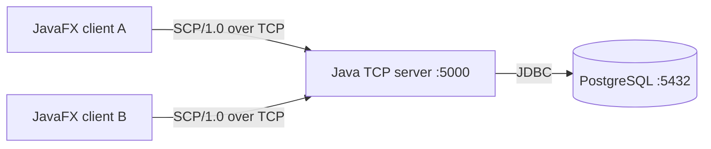
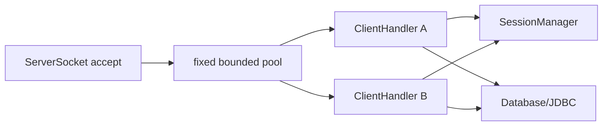
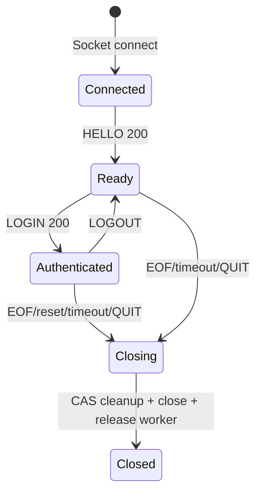
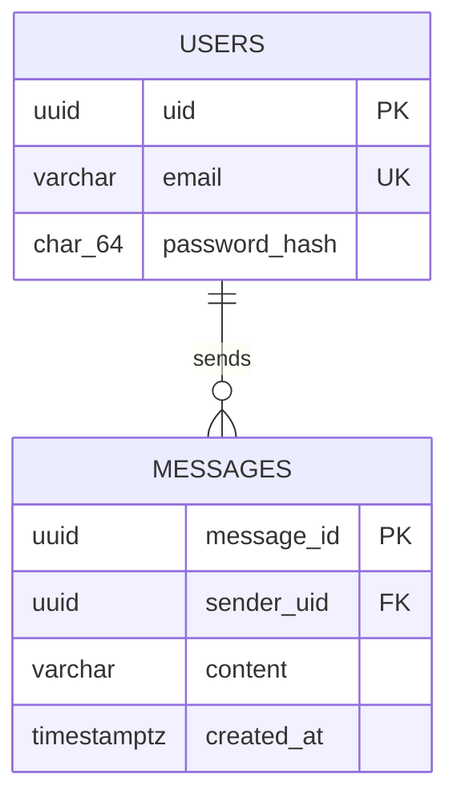
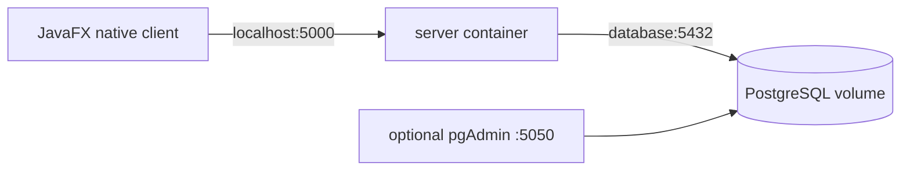

# System Architecture

## 1. Context

`client/` và `server/` là hai chương trình Java độc lập, không import source của nhau. Hợp đồng duy nhất là `docs/protocol-design.md`. JavaFX desktop client mở `java.net.Socket` trực tiếp nên không cần HTTP, WebSocket hay gateway trung gian.

## 2. Repository modules

| Path | Responsibility |
|---|---|
| `server/.../Protocol.java` | Frame reader/writer, JSON envelope, giới hạn frame |
| `server/.../ClientHandler.java` | State machine và command trên một connection |
| `server/.../SessionManager.java` | Online registry và broadcast thread-safe |
| `server/.../Database.java` | JDBC migrations, users, messages |
| `server/.../PasswordHasher.java` | SHA-256 theo yêu cầu |
| `client/.../ProtocolCodec.java` | Client-side framing độc lập |
| `client/.../TcpChatClient.java` | Socket, reader thread, pending requests/events |
| `client/.../ChatApplication.java` | JavaFX screens, state và UI actions |
| `client/.../app.css` | Design tokens/layout lấy cảm hứng từ Figma |

## 3. Server concurrency

Server dùng blocking socket với fixed `ThreadPoolExecutor` + `SynchronousQueue`. Accept loop chỉ nhận socket và submit; mỗi TCP connection sống chiếm một worker. `MAX_CLIENTS` mặc định 100. Pool đầy thì server cố gửi frame `503 SERVER_BUSY` rồi đóng client mới.

Trade-off: dễ giải thích/kiểm thử và bounded; mỗi idle connection vẫn chiếm platform thread. Nếu cần hàng nghìn client, cân nhắc Java NIO hoặc virtual threads.

## 4. Client concurrency

- JavaFX Application Thread chỉ vẽ UI và xử lý action ngắn.
- `connect()`/request completion dùng `CompletableFuture`, không block UI.
- Một daemon reader thread duy nhất đọc tuần tự SCP frame.
- `ConcurrentHashMap<requestId, CompletableFuture>` ghép response với action.
- Server event không có requestId được chuyển tới listener bằng `Platform.runLater`.
- `sendLock` giữ trọn thao tác write prefix + body để nhiều action không ghi xen byte.

## 5. Shared state and safety

| State | Protection | Invariant |
|---|---|---|
| Online sessions | `ConcurrentHashMap<UUID, ClientHandler>` + atomic map operations | Một uid/một session |
| Per-server socket output | Per-handler `sendLock` | Frame không xen kẽ |
| Cleanup state | `AtomicBoolean.compareAndSet` | Remove/broadcast left đúng một lần |
| Client pending requests | `ConcurrentHashMap` | Response complete đúng future |
| Users/messages | PostgreSQL unique/FK constraints | Email unique, message có sender hợp lệ |

Broadcast lấy snapshot, không giữ global lock khi network I/O. Write lỗi chỉ cleanup session liên quan.

## 6. Lifecycle

Client đóng socket khi cửa sổ JavaFX đóng. Server đi qua `finally/cleanup`; remove `(uid, expectedHandler)` không thể xóa nhầm session mới.

## 7. Database

Theo yêu cầu, bảng `users` chỉ có `uid`, `email`, `password_hash`. Email normalize lowercase. Java server chạy migration idempotent khi start; PostgreSQL Compose tạo database/user/volume. pgAdmin chỉ là công cụ quan sát tùy chọn.

## 8. Deployment

- `docker compose up --build` khởi động PostgreSQL + Java server.
- JavaFX client chạy native bằng Maven; `CLIENT_TARGET_HOST=localhost`, `CLIENT_TARGET_PORT=5000`.
- Server trong container bind `0.0.0.0`; JDBC dùng Docker DNS `database` qua environment.

## 9. Decisions

| Decision | Alternative | Reason/trade-off |
|---|---|---|
| JavaFX direct TCP | Browser + WebSocket gateway | Một protocol end-to-end, không cần bridge |
| 4-byte length JSON | Delimiter/binary | An toàn newline, dễ debug; có overhead JSON |
| Fixed blocking pool | NIO selector | Dễ bảo vệ vấn đáp, bounded ở quy mô môn học |
| PostgreSQL | In-memory | Persistence và constraint nguyên tử |
| UUID uid | Sequence | ID opaque, không phụ thuộc DB sequence |
| SHA-256 | Argon2id/bcrypt | Yêu cầu người dùng; yếu hơn production password hashing |
