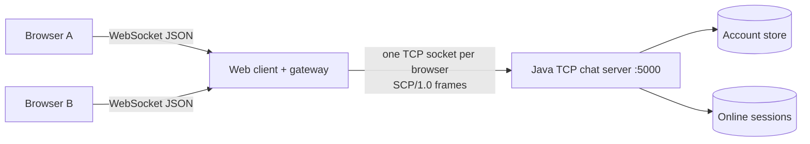
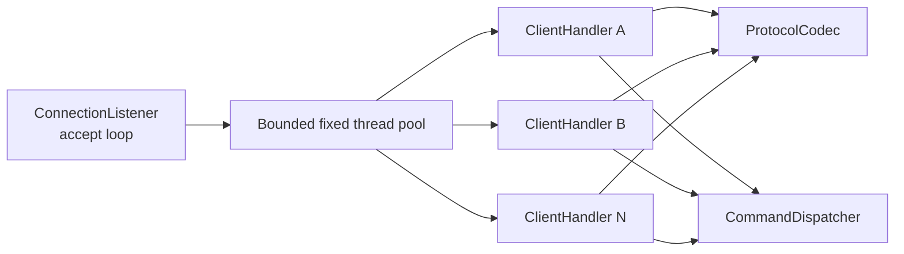
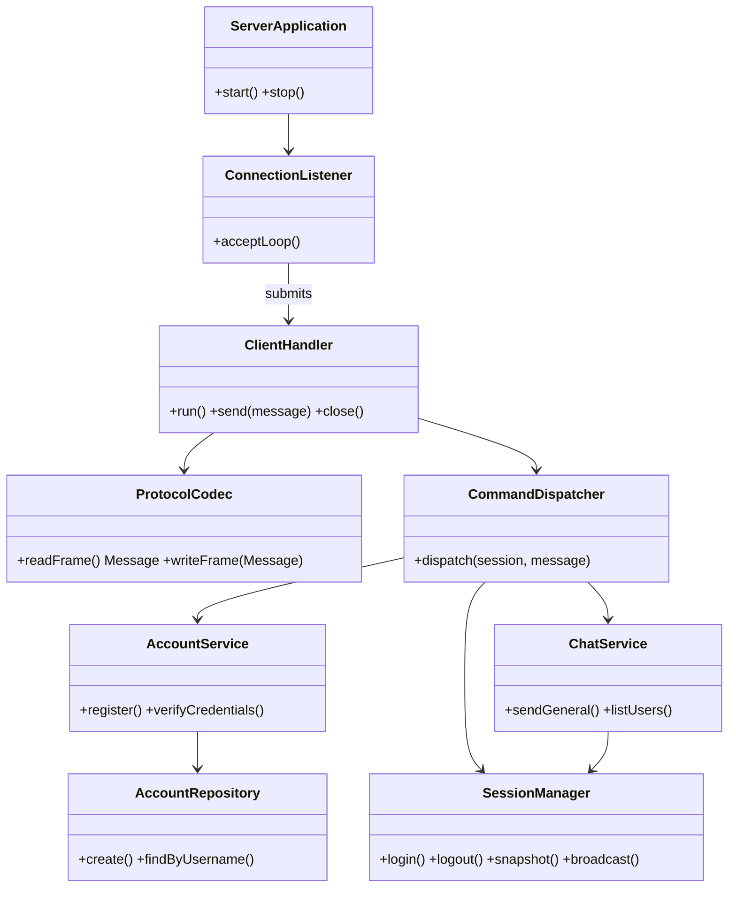
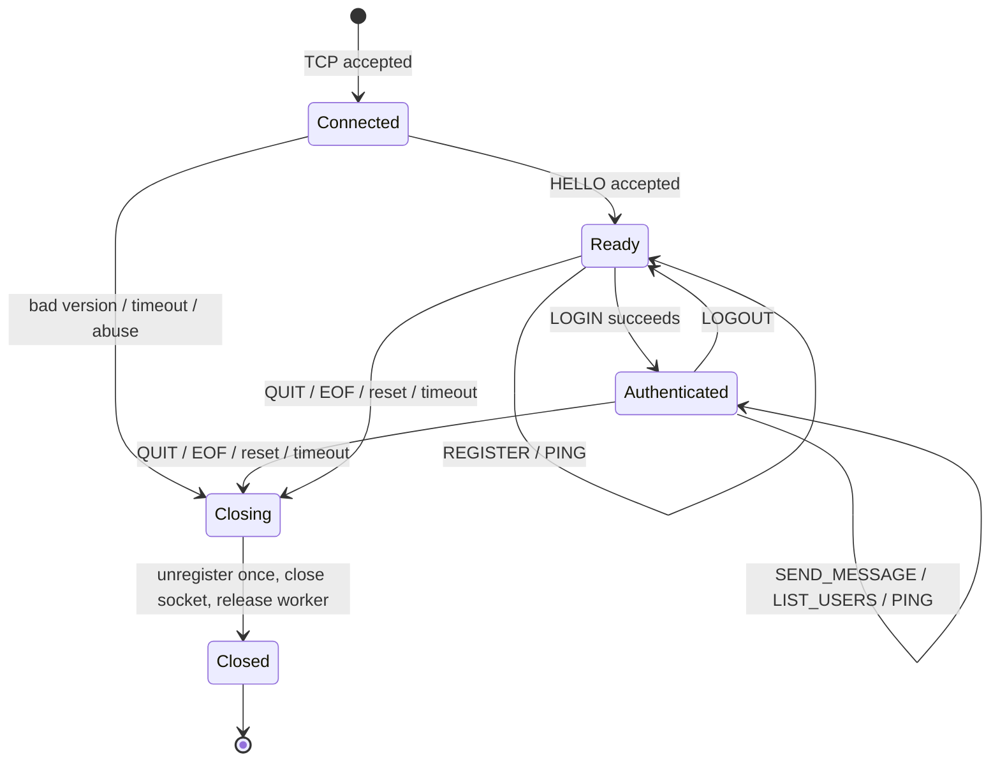
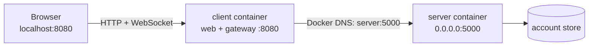

# System Architecture

> Kiến trúc mục tiêu cho web chat SCP/1.0. Cập nhật tài liệu nếu package/class thực tế thay đổi trong M2.

## 1. System Context

Browser không mở raw TCP socket. Gateway thuộc client: nó phục vụ web, nhận WebSocket và mở một TCP socket độc
lập tới server cho mỗi browser. Gateway chuyển WebSocket JSON thành SCP frame và ngược lại; nó không xác thực tài
khoản và không quyết định luật chat.

## 2. Server Concurrency Model

Server dùng blocking I/O với `ThreadPoolExecutor` cố định, tối đa mặc định 100 worker. Accept loop chỉ nhận socket
và giao `ClientHandler` cho pool. Mỗi connection dài hạn chiếm một worker; khi đạt giới hạn, server trả
`503 SERVER_BUSY` nếu có thể rồi đóng socket mới.

Mô hình phù hợp quy mô lớp học và dễ test/giải thích hơn Java NIO. Trade-off: số client bị giới hạn bởi worker;
nếu cần hàng nghìn client sẽ cân nhắc NIO `Selector`, không tăng thread vô hạn.

## 3. Components and Planned Modules

| Planned path/module | Responsibility | Planned owner |
|---------------------|----------------|---------------|
| `server/.../protocol/` | Frame reader/writer, JSON codec, validation, message types/status | Nguyễn Đức Hải |
| `server/.../server/` | Bootstrap, env config, accept loop, worker pool, shutdown | Ngô Hoàng Minh |
| `server/.../auth/` | Register/login/logout, password hashing, account repository | Ngô Hoàng Minh |
| `server/.../session/` | Online registry, unique login, presence and cleanup | Ngô Hoàng Minh |
| `server/.../chat/` | `SEND_MESSAGE`, `LIST_USERS`, general broadcast orchestration | Nguyễn Đức Hải |
| `client/.../gateway/` | WebSocket lifecycle, 1:1 TCP bridge, reconnect/error mapping | Quách Thành Đạt |
| `client/.../web/` | Register/login/chat/presence UI and client state | Quách Thành Đạt |
| `tests/protocol/` | Split/coalesced/oversized frame and schema tests | Nguyễn Đức Hải |
| `tests/server/` | Auth race, duplicate login, cleanup and load tests | Ngô Hoàng Minh |
| `tests/e2e/` | Browser–gateway–server flows and Docker smoke tests | Quách Thành Đạt |

Đây là **phân công dự kiến**, không phải bằng chứng đóng góp. Bảng Contribution trong README chỉ điền theo
commit/PR và phần nhóm thực sự hoàn thành.

## 4. Server Component Relationships

## 5. Shared State and Thread Safety

| Shared state | Accessed by | Protection | Rule |
|--------------|-------------|------------|------|
| Account records | Concurrent register/login handlers | Repository transaction + unique normalized username | Hash ngoài global lock; unique constraint chọn winner |
| Online sessions | Login/logout/chat/disconnect handlers | `ConcurrentHashMap` + atomic `putIfAbsent` | Remove bằng key + expected session |
| Per-session output | Response and broadcast threads | One `sendLock` per session | Lock chỉ quanh write+flush một frame |
| Session state | Handler, cleanup, shutdown | Atomic/guarded transition | Cleanup idempotent, `USER_LEFT` đúng một lần |
| Connection counters | Listener and handlers | Atomic counter/executor metrics | Giảm trong `finally` |

Không giữ khóa toàn cục trong network I/O. Broadcast lấy snapshot rồi gửi từng session; một client chậm/lỗi không
ngăn gửi cho người khác. Không giữ đồng thời account lock và send lock để tránh deadlock.

## 6. Connection Lifecycle

Mọi đường thoát qua cleanup idempotent trong `finally`: gỡ đúng session hiện tại, phát `USER_LEFT` nếu cần, đóng
stream/socket và giải phóng worker/counter. Gateway đóng WebSocket khi TCP đóng và ngược lại.

## 7. Authentication and Data

- Account gồm normalized username, display name, password hash và creation time.
- Password chỉ tạm xuất hiện trong `REGISTER`/`LOGIN`; không ghi log, event hoặc response.
- Repository có unique constraint trên normalized username và tạo account nguyên tử.
- Một account có một session online; `putIfAbsent` ngăn hai login đồng thời cùng thắng.
- Chat history không phải Must have; server chỉ broadcast message trong bộ nhớ.

## 8. Deployment

| Service | Planned runtime | Exposed port | Configuration |
|---------|-----------------|--------------|---------------|
| `server` | Java TCP server | `5000` | `SERVER_HOST`, `SERVER_PORT`, max clients/timeouts/store path |
| `client` | Web UI + gateway | `8080` | `CLIENT_TARGET_HOST=server`, `CLIENT_TARGET_PORT=5000`, web port |

Chỉ client container dùng hostname `server`; browser dùng `localhost:8080` hoặc domain/IP host. Không hard-code
địa chỉ. `docker compose up --build` tối thiểu phải khởi động server; cấu hình cuối M2 phải cung cấp cách khởi động
web client trong README.

## 9. Design Decisions

| Decision | Alternatives | Reason and trade-off |
|----------|--------------|----------------------|
| Raw TCP server + web gateway | WebSocket server; desktop client | Giữ framing tự thiết kế nhưng thêm adapter lifecycle |
| 4-byte length-prefixed JSON | Newline; binary | An toàn với newline, dễ debug; cần kiểm tra length |
| Fixed blocking thread pool | Unlimited threads; NIO | Dễ hiểu và bounded; mỗi client chiếm worker |
| Stateful authentication | Stateless token | Presence/unique login đơn giản; cleanup khó hơn |
| One general channel | Multi-room/private chat | Đủ broadcast/concurrency và giữ phạm vi M3 |
