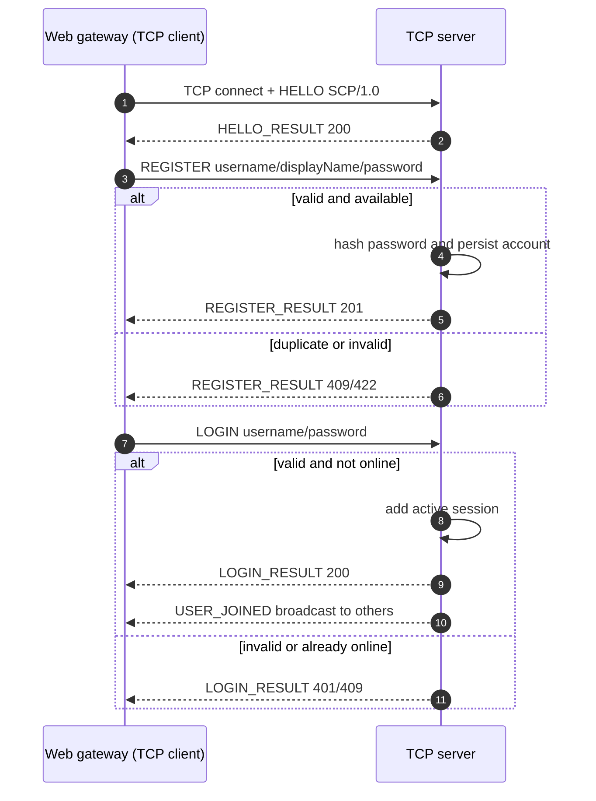
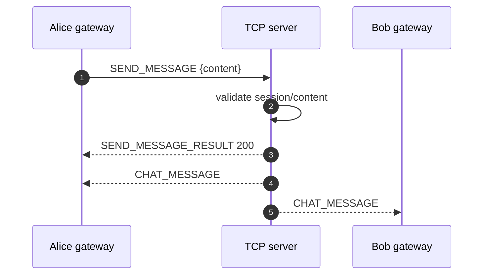
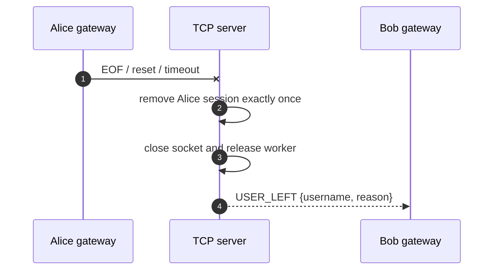

# Simple Chat Protocol — SCP/1.0

> Tài liệu này đặc tả giao thức tầng ứng dụng giữa web gateway (TCP client) và Java chat server. Browser dùng
> WebSocket tới gateway vì browser không hỗ trợ raw TCP; WebSocket không thay thế giao thức SCP/1.0.

## 1. Overview

| Property | Our choice | Why |
|----------|------------|-----|
| Protocol | Simple Chat Protocol — `SCP/1.0` | Có version để phát hiện client/server không tương thích |
| Transport | TCP | Chat cần tin cậy và đúng thứ tự; UDP sẽ cần tự làm retransmission và ordering |
| Default port | `5000` | Cấu hình qua biến môi trường, không hard-code trong code |
| Framing | 4-byte unsigned big-endian length prefix | TCP là byte stream; prefix cho phép đọc đúng một JSON dù dữ liệu bị chia/gộp |
| Data format | UTF-8 JSON | Dễ debug, độc lập ngôn ngữ và phù hợp dữ liệu chat |
| Session model | Stateful | Server nhớ handshake và tài khoản đăng nhập trên từng connection |
| Chat model | Một kênh tổng | Mọi người dùng đã xác thực đều nhận broadcast |

## 2. Message Framing

```text
+--------------------------+---------------------------------------+
| Length N (4 bytes, BE)   | N bytes UTF-8 JSON payload            |
+--------------------------+---------------------------------------+
```

- `N` là số byte của JSON UTF-8, không phải số ký tự và không tính 4 byte prefix.
- `1 <= N <= 65,536`. Receiver đọc đủ 4 byte prefix rồi lặp đến khi nhận đủ `N` byte body.
- Không giả định một lần `read()` trả trọn frame; một `read()` cũng có thể chứa dữ liệu của nhiều frame.
- Nếu `N = 0` hoặc `N > 65,536`, server gửi `ERROR` code `413` nếu còn ghi được rồi đóng connection, không cấp
  phát buffer theo độ dài sai.
- JSON sai cú pháp/schema nhận `400`. Sau 3 lỗi malformed trên cùng connection, server đóng connection. Đăng nhập
  sai không tính là malformed.

## 3. Message Format

Request:

```json
{
  "type": "LOGIN",
  "requestId": "r-102",
  "payload": { "username": "alice", "password": "example-only" }
}
```

| Field | Rule |
|-------|------|
| `type` | Chuỗi in hoa; phải là command đã định nghĩa |
| `requestId` | Chuỗi 1–64 ký tự, duy nhất trong các request đang chờ của connection |
| `payload` | JSON object; schema phụ thuộc `type` |

Response:

```json
{
  "type": "LOGIN_RESULT",
  "requestId": "r-102",
  "status": 200,
  "message": "Login successful",
  "data": { "username": "alice", "displayName": "Alice" }
}
```

Server event:

```json
{
  "type": "CHAT_MESSAGE",
  "eventId": "e-381",
  "payload": {
    "from": "alice",
    "displayName": "Alice",
    "content": "Xin chào",
    "sentAt": "2026-11-03T09:15:30Z"
  }
}
```

Response giữ nguyên `requestId`; event dùng `eventId` và không có `requestId`. Thời gian dùng UTC ISO-8601.
Password/password hash không bao giờ xuất hiện trong response, event hoặc log.

## 4. Connection State

```text
CONNECTED --HELLO/200--> READY --LOGIN/200--> AUTHENTICATED
READY --REGISTER/201--> READY
AUTHENTICATED --LOGOUT/200--> READY
CONNECTED | READY | AUTHENTICATED --QUIT--> CLOSED
```

- Command đầu tiên phải là `HELLO`; nếu không, trả `400 INVALID_STATE`.
- `REGISTER`, `LOGIN` chỉ hợp lệ ở `READY`.
- `SEND_MESSAGE`, `LIST_USERS`, `LOGOUT` chỉ hợp lệ ở `AUTHENTICATED`.
- `PING`, `QUIT` hợp lệ ở mọi trạng thái.
- Một username chỉ có một session online; login lần hai nhận `409 ALREADY_ONLINE`.

## 5. Command Reference

| Command | State | Payload | Response | Purpose |
|---------|-------|---------|----------|---------|
| `HELLO` | CONNECTED | `protocolVersion`, `clientName` | `HELLO_RESULT` 200/426 | Kiểm tra version và vào READY |
| `REGISTER` | READY | `username`, `displayName`, `password` | `REGISTER_RESULT` 201/409/422 | Tạo tài khoản, không tự đăng nhập |
| `LOGIN` | READY | `username`, `password` | `LOGIN_RESULT` 200/401/409 | Xác thực và đăng ký session online |
| `SEND_MESSAGE` | AUTHENTICATED | `content` | `SEND_MESSAGE_RESULT` 200/422 | Gửi tin vào chat tổng |
| `LIST_USERS` | AUTHENTICATED | `{}` | `LIST_USERS_RESULT` 200 | Lấy snapshot người online |
| `LOGOUT` | AUTHENTICATED | `{}` | `LOGOUT_RESULT` 200 | Gỡ session, quay lại READY |
| `PING` | any | `clientTime` tùy chọn | `PONG` 200 | Kiểm tra liveness |
| `QUIT` | any | `reason` tùy chọn | `QUIT_ACK` 200 rồi đóng | Đóng có trật tự |

Validation:

- `username`: 3–32 ký tự ASCII, regex `^[a-zA-Z0-9_]+$`; so sánh không phân biệt hoa/thường và lưu lowercase.
- `displayName`: 1–50 ký tự Unicode sau khi trim.
- `password`: 8–72 byte UTF-8; chỉ truyền trong `REGISTER`/`LOGIN`, chỉ lưu hash có salt.
- `content`: 1–2,000 ký tự Unicode sau khi trim; không chấp nhận rỗng.

## 6. Server Events

| Event | Recipients | Payload | When |
|-------|------------|---------|------|
| `CHAT_MESSAGE` | Mọi session authenticated, gồm người gửi | `from`, `displayName`, `content`, `sentAt` | Sau khi chấp nhận `SEND_MESSAGE` |
| `USER_JOINED` | Các session authenticated khác | `username`, `displayName` | Sau `LOGIN` thành công |
| `USER_LEFT` | Các session authenticated còn lại | `username`, `displayName`, `reason` | Logout, quit, EOF, reset hoặc timeout |

Server validate → trả `SEND_MESSAGE_RESULT` → broadcast `CHAT_MESSAGE`. Thứ tự giữa hai người gửi đồng thời không
được đảm bảo toàn cục, nhưng frame trên cùng socket phải nguyên vẹn và theo thứ tự server ghi.

## 7. Status Codes

| Code | Name | Meaning |
|:----:|------|---------|
| 200 | `OK` | Thành công |
| 201 | `CREATED` | Tạo tài khoản thành công |
| 400 | `BAD_REQUEST` | JSON/schema sai, command lạ hoặc sai state |
| 401 | `UNAUTHORIZED` | Sai đăng nhập hoặc chưa đăng nhập |
| 409 | `CONFLICT` | Username tồn tại hoặc tài khoản đang online |
| 413 | `TOO_LARGE` | Frame vượt 65,536 byte |
| 422 | `VALIDATION_ERROR` | Field vi phạm độ dài/định dạng |
| 426 | `VERSION_UNSUPPORTED` | Version SCP không hỗ trợ |
| 429 | `TOO_MANY_REQUESTS` | Vượt giới hạn request/message |
| 500 | `INTERNAL_ERROR` | Lỗi server; không trả stack trace |
| 503 | `SERVER_BUSY` | Đạt giới hạn connection/worker |

## 8. Main Flows

### Register and login



### General chat



### Abrupt disconnect



## 9. Limits, Timeouts and Safety

| Rule | Value | Reason |
|------|-------|--------|
| Max frame body | 65,536 bytes | Chặn cấp phát theo prefix độc hại |
| Max chat content | 2,000 Unicode characters | Giới hạn abuse và UI |
| Read idle timeout | 90 seconds | Phát hiện connection im lặng |
| Keep-alive | Gateway gửi `PING` mỗi 30 seconds | Kiểm tra đường truyền |
| Max TCP clients | 100, configurable | Khớp blocking fixed pool |
| Malformed strikes | 3 per connection | Cho phép lỗi vô ý, hạn chế spam parser |
| Password storage | Salted adaptive hash | Không lưu plaintext; ghi thuật toán/cost khi triển khai |

TLS, end-to-end encryption và reset password nằm ngoài M3. Không dùng mật khẩu thật khi demo.

## 10. Design Rationale

- **TCP thay UDP:** reliability và ordering phù hợp chat; không phải tự làm ACK/retransmission.
- **Length prefix thay delimiter:** JSON có thể chứa newline và cách này minh họa TCP split/coalescing; phải kiểm tra
  length trước khi cấp phát.
- **JSON thay binary:** dễ đọc/debug khi vấn đáp; frame lớn hơn và cần validation chặt.
- **Stateful session:** cần biết connection đã login để phân quyền/presence; cleanup disconnect phức tạp hơn.
- **Gateway thay WebSocket trực tiếp ở server:** browser có UI web nhưng giao thức được chấm vẫn là SCP/1.0 raw TCP.
