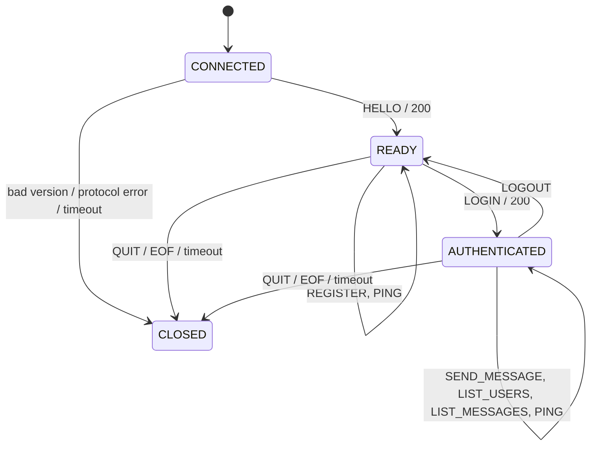
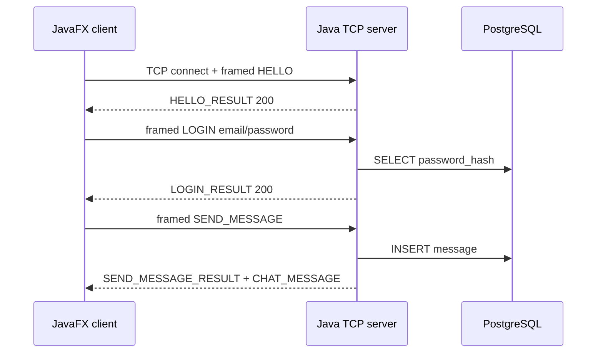

# Simple Chat Protocol — SCP/1.0

SCP/1.0 là giao thức tầng ứng dụng giữa JavaFX desktop client và Java server. Hai chương trình độc lập, giao tiếp trực tiếp bằng raw TCP socket.

## 1. Transport and framing

| Property | Value | Rationale |
|---|---|---|
| Transport | TCP | Tin cậy và đúng thứ tự; không phải tự làm ACK/retransmission như UDP |
| Default port | `5000` | Lấy từ environment |
| Encoding | UTF-8 JSON | Dễ debug và độc lập ngôn ngữ |
| Framing | 4-byte unsigned big-endian length + body | Xử lý đúng TCP split/coalescing |
| Maximum body | 65,536 bytes | Chặn prefix độc hại gây cấp phát quá lớn |

```text
+------------------------+------------------------------+
| N: 4 bytes, big-endian | N bytes UTF-8 JSON           |
+------------------------+------------------------------+
```

Receiver phải `readFully(4)`, kiểm tra `1 <= N <= 65,536`, rồi lặp tới khi đủ N byte. `read()` không tương ứng với message: một frame có thể bị chia qua nhiều packet hoặc nhiều frame nằm trong cùng một packet. `N=0`/quá lớn nhận `413` nếu socket còn ghi được rồi connection bị đóng. JSON/schema sai nhận `400`; ba malformed strike đóng connection.

## 2. Envelope

Request:

```json
{"type":"LOGIN","requestId":"r-102","payload":{"email":"alice@example.com","password":"example-only"}}
```

Response:

```json
{"type":"LOGIN_RESULT","requestId":"r-102","status":200,"message":"Login successful","data":{"uid":"...","email":"alice@example.com"}}
```

Event:

```json
{"type":"CHAT_MESSAGE","eventId":"...","payload":{"messageId":"...","senderUid":"...","email":"alice@example.com","content":"Xin chào","sentAt":"2026-11-04T14:00:00Z"}}
```

- `type`: command in hoa đã định nghĩa.
- `requestId`: 1–64 ký tự, response giữ nguyên ID để client ghép `CompletableFuture`.
- `payload`: JSON object, kể cả command không có tham số.
- `eventId`: UUID do server sinh; event không có `requestId`.
- Thời gian: UTC ISO-8601. Password/hash không xuất hiện trong response, event hoặc log.

## 3. Connection state



Command đầu tiên phải là `HELLO`. Một `uid` chỉ có một session online; login lần hai nhận `409`. Client có thể gửi `PING` định kỳ; server timeout connection im lặng sau 90 giây.

## 4. Commands

| Command | State | Payload | Response | Purpose |
|---|---|---|---|---|
| `HELLO` | CONNECTED | `protocolVersion`, `clientName` | `HELLO_RESULT` 200/426 | Thỏa thuận `SCP/1.0` |
| `REGISTER` | READY | `email`, `password` | `REGISTER_RESULT` 201/409/422 | Tạo tài khoản, chưa login |
| `LOGIN` | READY | `email`, `password` | `LOGIN_RESULT` 200/401/409 | Xác thực session |
| `SEND_MESSAGE` | AUTHENTICATED | `content` | `SEND_MESSAGE_RESULT` 200/422 | Lưu và broadcast |
| `LIST_USERS` | AUTHENTICATED | `{}` | `LIST_USERS_RESULT` 200 | Snapshot người online |
| `LIST_MESSAGES` | AUTHENTICATED | `limit` (1–100) | `LIST_MESSAGES_RESULT` 200 | Lịch sử gần nhất |
| `LOGOUT` | AUTHENTICATED | `{}` | `LOGOUT_RESULT` 200 | Gỡ session, về READY |
| `PING` | any | `{}` | `PONG` 200 | Keep-alive |
| `QUIT` | any | `{}` | `QUIT_ACK` 200 | Đóng chủ động |

Validation:

- `email`: trim, lowercase, tối đa 254 ký tự, dạng `local@domain.tld`; unique trong PostgreSQL.
- `password`: 8–72 byte UTF-8; server băm SHA-256 và chỉ lưu 64 ký tự hex.
- `content`: trim, 1–2,000 Unicode code point.
- `limit`: server clamp về 1–100, mặc định 50.

## 5. Events

| Event | Recipients | Payload |
|---|---|---|
| `CHAT_MESSAGE` | Mọi session authenticated, gồm sender | `messageId`, `senderUid`, `email`, `content`, `sentAt` |
| `USER_JOINED` | Các session khác | `uid`, `email` |
| `USER_LEFT` | Các session còn lại | `uid`, `email`, `reason` |

`SEND_MESSAGE_RESULT` được ghi về sender trước khi `CHAT_MESSAGE` được broadcast. Mỗi socket có `sendLock`, vì response thread và broadcast thread có thể cùng ghi; nếu không khóa, bytes của hai frame có thể xen kẽ.

## 6. Status codes

| Code | Name | Meaning |
|---:|---|---|
| 200 | OK | Thành công |
| 201 | CREATED | Account được tạo |
| 400 | BAD_REQUEST | Sai JSON/schema/command/state |
| 401 | UNAUTHORIZED | Sai credentials hoặc chưa login |
| 409 | CONFLICT | Email tồn tại hoặc account đang online |
| 413 | TOO_LARGE | Frame vượt giới hạn |
| 422 | VALIDATION_ERROR | Field không hợp lệ |
| 426 | VERSION_UNSUPPORTED | Không phải SCP/1.0 |
| 500 | INTERNAL_ERROR | Lỗi server, không lộ stack trace |
| 503 | SERVER_BUSY | Hết worker/connection capacity |

## 7. Main flow



## 8. Password decision

Yêu cầu sản phẩm bắt buộc SHA-256 nên implementation dùng `SHA-256(UTF-8(password))`, hex lowercase, và so sánh bằng `MessageDigest.isEqual`. Đây là hash nhanh, không salt và **không phải lựa chọn khuyến nghị cho production** vì dễ brute-force/rainbow table. Phương án tốt hơn là Argon2id, bcrypt hoặc PBKDF2 với salt/cost; đổi thuật toán sẽ cần thêm metadata vào bảng users và migration protocol/storage.
